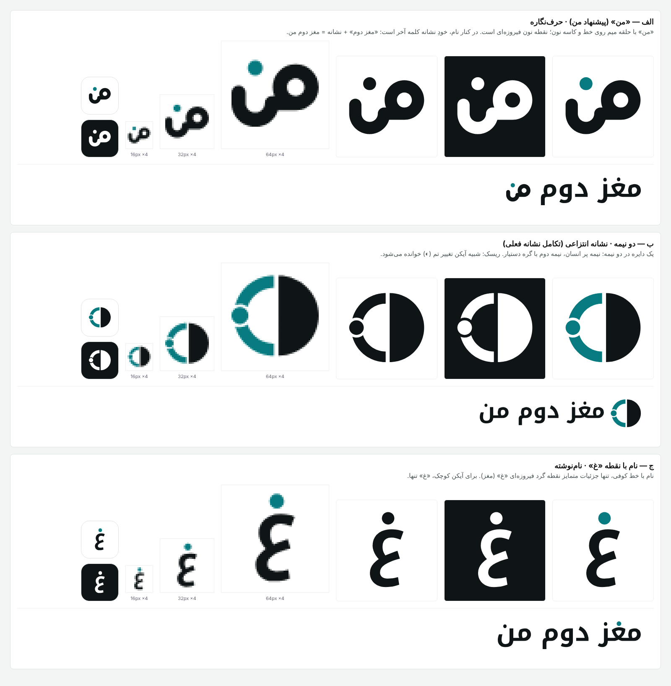

# نشانه «مغز دوم من»



## ایده

نشانه، کلمه **«من»** است: حلقه میم روی خط کرسی، خط که در کاسه نون فرو می‌رود، و **نقطه نون به رنگ فیروزه‌ای**. «مغز دوم من» برای «من» است؛ نقطه فیروزه‌ای همان فکری است که دستیار برایتان نگه می‌دارد.

کنار نام، خودِ نشانه کلمه آخر است: «مغز دوم» با خط کوفی و بعد نشانه. پس هرگز «مغز دوم من» را کامل کنار نشانه ننویسید (می‌شود «من مغز دوم من»).

| طرح | نوع | چرا انتخاب نشد |
|---|---|---|
| الف — «من» | حرف‌نگاره | انتخاب شد |
| ب — دو نیمه | انتزاعی (تکامل نشانه قبلی) | شبیه آیکن تغییر تم (◐) خوانده می‌شود |
| ج — نقطه «غ» | نام‌نوشته | نشانه کوچکش («غ») به اندازه «من» معنا ندارد |

## ساختار

روی شبکه ۲۵۶، ضخامت خط ۳۶ (همه اجزا از دایره، نوار قوس‌دار و خط با سر گرد ساخته و با هم ادغام شده‌اند؛ بدون متن زنده، بدون stroke):

- میم: حلقه به مرکز (۱۸۴، ۱۱۰)، شعاع بیرونی ۵۸ و درونی ۲۲
- خط کرسی: از (۱۲۴، ۱۵۰) تا (۱۸۴، ۱۵۰)
- نون: نیمه پایینی نوار به شعاع ۴۲ حول (۸۲، ۱۵۰)، بازوی چپ تا ارتفاع ۱۲۴
- نقطه: دایره (۸۲، ۶۲) با شعاع ۱۹

فاصله بالای حلقه تا پایین خط (۱۱۶ واحد) با ارتفاع x خط Noto Kufi Arabic (۴۹۵ از ۱۰۰۰) برابر شده؛ پس در قفل‌بندی ضخامت نشانه با ضخامت الف یکی است و خط کرسی‌اش روی خط کرسی متن می‌نشیند.

`build_brand.py` همه فایل‌ها را از همین ساختار دوباره می‌سازد.

## رنگ

| نقش | روی زمینه روشن | روی زمینه تیره |
|---|---|---|
| جوهر (نشانه و نام) | `#0F1516` | `#EEF2F2` |
| نقطه (سیگنال) | `#087B81` | `#33C3C3` |

نسخه تک‌رنگ (سیاه یا سفید) برای چاپ، مهر و حکاکی است؛ در آن نقطه هم‌رنگ بقیه می‌شود. رنگ نقطه را عوض نکنید و رنگ دیگری اضافه نکنید.

## فاصله و اندازه

- **حریم:** دور نشانه دست‌کم به اندازه قطر نقطه (۳۸ واحد) خالی بماند؛ دور قفل‌بندی، به اندازه ارتفاع حلقه میم.
- **کمترین اندازه:** نشانه تنها ۱۶ پیکسل (روی کاشی تیره) و ۲۰ پیکسل (بدون کاشی)؛ قفل‌بندی با ارتفاع ۲۴ پیکسل.
- آیکن برنامه: کاشی تمام‌رخ `#0F1516`، نشانه سفید با نقطه `#33C3C3` در ۶۰٪ عرض (نسخه maskable در ۵۰٪).

## نادرست

- کشیدن، چرخاندن، سایه، گرادیان یا دورخط
- نوشتن «من» با فونت کنار نشانه، یا تکرار کل نام کنار آن
- گذاشتن نشانه روی عکس شلوغ بدون کاشی
- نقطه به رنگی جز فیروزه‌ای (یا هم‌رنگ نشانه در نسخه تک‌رنگ)

## فایل‌ها

در `frontend/public/brand/`: `mark.svg`، `mark-black.svg`، `mark-white.svg`، `mark-reversed.svg`، `lockup.svg`، `lockup-black.svg`، `lockup-reversed.svg`، `app-icon.svg`، `app-icon-maskable.svg`، `app-icon-1024.png`. فاوآیکن‌ها و آیکن‌های PWA در `frontend/public/` و کامپوننت `BrandMark` / `Wordmark` در `frontend/src/components/brand/BrandMark.tsx`.

ساخت دوباره:

```bash
pip install fonttools brotli uharfbuzz skia-pathops
python brand/build_brand.py frontend/node_modules/@fontsource/noto-kufi-arabic/files/noto-kufi-arabic-arabic-700-normal.woff2 brand/out
```

فایل‌های PNG با هر مبدل SVG (مثلاً `rsvg-convert` یا مرورگر) از SVGهای خروجی ساخته می‌شوند: فاوآیکن ۱۶/۳۲/۴۸ از `favicon-tile.svg`، و `apple-touch-icon` (۱۸۰) و `android-chrome` (۱۹۲/۵۱۲) از `app-icon.svg`.

## یادداشت

- خط کوفی قفل‌بندی Noto Kufi Arabic Bold (مجوز SIL OFL، استفاده در لوگو مجاز) است و به مسیر تبدیل شده؛ به نصب فونت نیازی نیست.
- پیش از ثبت علامت تجاری، جستجوی رسمی (اداره ثبت علائم و جستجوی تصویر معکوس) لازم است.
